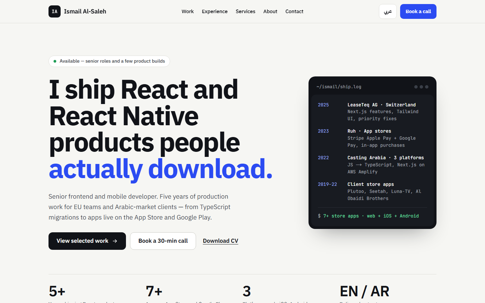
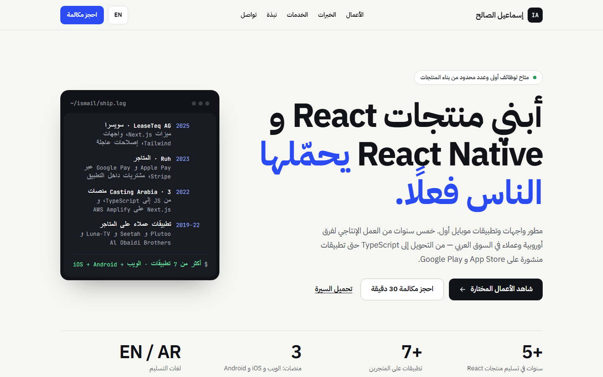

# Ismail Al-Saleh — portfolio

[](https://github.com/ismail2009/portfolio-next/actions/workflows/ci.yml)

Personal portfolio of a senior frontend and mobile developer, in English and Arabic.

**Design:** [Portfolio Redesign artboards](https://claude.ai/artifact/Sp2Fnw5ea7J3mXppVgNbC7)

**Live:** https://ismail-alsaleh.vercel.app ([English](https://ismail-alsaleh.vercel.app/en) · [العربية](https://ismail-alsaleh.vercel.app/ar))

- Next.js 16 (App Router, Cache Components) with every page prerendered
- English and Arabic with full right-to-left layout, via [next-intl](https://next-intl.dev)
- Content edited in [Keystatic](https://keystatic.com); each save is a Git commit
- Tailwind CSS 4, `next/font`, generated Open Graph images
- Lighthouse: 100 for accessibility, best practices and SEO

| English                                   | العربية                                  |
| ----------------------------------------- | ---------------------------------------- |
|  |  |

## Running it

Requires Node 24 (see `.node-version`).

```bash
npm ci
npm run dev      # http://localhost:3000, admin at /keystatic
npm run check    # lint, typecheck and format check (what CI runs)
npm run build    # production build
```

## Project layout

| Path                           | What's there                                              |
| ------------------------------ | --------------------------------------------------------- |
| `src/app/[locale]/`            | Pages: home, case studies (`work/[slug]`), thank-you, 404 |
| `src/components/`              | UI, with the home page sections in `home/`                |
| `src/i18n/`                    | Locales and routing (`en`, `ar`, always prefixed)         |
| `messages/`                    | Interface strings for each language                       |
| `content/`                     | Site content as YAML, written by Keystatic                |
| `keystatic.config.ts`          | Content schema and storage mode                           |
| `scripts/import-firestore.mjs` | One-time import from the previous site                    |

## Content

Content lives in `content/`: profile, settings, projects, experience, testimonials and social links. Every text field has an English and an Arabic value; when the Arabic one is empty, `/ar` shows the English text.

**In development**, `/keystatic` reads and writes the local files directly.

**In production**, `/keystatic` logs in with GitHub and commits each save to `main`, which triggers a deploy. The admin and its API return 404 until all four variables below are set:

| Variable                                | From                     |
| --------------------------------------- | ------------------------ |
| `KEYSTATIC_GITHUB_CLIENT_ID`            | The Keystatic GitHub App |
| `KEYSTATIC_GITHUB_CLIENT_SECRET`        | The Keystatic GitHub App |
| `KEYSTATIC_SECRET`                      | Any long random string   |
| `NEXT_PUBLIC_KEYSTATIC_GITHUB_APP_SLUG` | The app's URL name       |

`keystatic.config.ts` also runs in the browser, which only sees `NEXT_PUBLIC_` variables, so the storage mode is chosen from the public app slug.

`content/` is excluded from Prettier: Keystatic writes its own YAML style, and reformatting it would churn every save.

## Deployment

Hosted on Vercel. A push to `main` deploys to production, and other branches get preview URLs. GitHub Actions runs `npm run check` and a build on pushes to `main` and on pull requests.

| Variable               | Purpose                                                                                                |
| ---------------------- | ------------------------------------------------------------------------------------------------------ |
| `NEXT_PUBLIC_SITE_URL` | Canonical URL for metadata, hreflang and the sitemap. Defaults to `https://ismail-alsaleh.vercel.app`. |

The contact form posts to [FormSubmit](https://formsubmit.co), which needs a one-time activation from the address in `content/settings.yaml`. Changing that address means activating it again.

## Dependency updates

Dependabot opens weekly npm and monthly GitHub Actions updates. `.github/dependabot.yml` holds some majors back on purpose:

- `@types/node` follows the Node runtime (24), so it moves together with `.node-version`.
- TypeScript 7 waits until Next.js supports it.
- ESLint 10 waits until `eslint-config-next` supports it (its React and a11y plugins stop at ESLint 9). This one is ignored through a Dependabot comment on the closed PR rather than in the config file.

## Contact

Use the [contact form](https://ismail-alsaleh.vercel.app/en#contact) on the site, or find me on [LinkedIn](https://www.linkedin.com/in/ismail-alsaleh/).

## License

The code is [MIT](LICENSE). The site content, images and CV are © Ismail Al-Saleh and not covered by the license.
